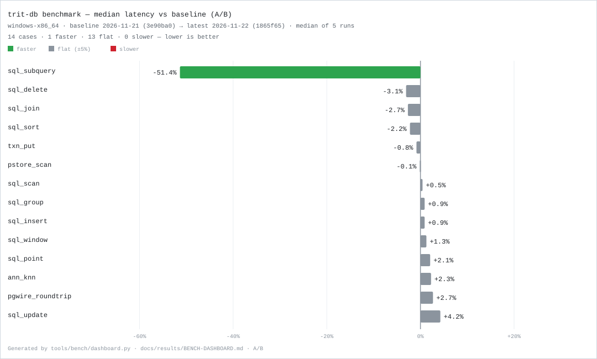

# trit-db

<!-- BENCH-SUMMARY:BEGIN -->
## 性能涨跌看板

<a href="docs/results/BENCH-DASHBOARD.md"></a> <a href="docs/results/BENCH-DASHBOARD.md"></a>

> `3e90ba0` → `6ea161d` · `windows-x86_64` · 15 项 · 最近 5 次中位数 · 2026-11-22 · 延迟越低越好



| 口径 | 更快 / 持平 / 更慢 | Δ% 中位数 |
|---|---|---|
| 5 次聚合（历史） | 4 / 6 / 4 | -0.9% |
| A/B 复核（写路径判定，4 项） | 0 / 4 / 0 | +0.8% |
| 单次直比（仅参考） | 4 / 5 / 5 | +3.3% |

| 重点 | 数值 |
|---|---|
| 最大提升 | `sql_subquery` -52.5%（快 2.10×） |
| A/B 最大退化 | 无（4 项均 <5%，最大 `sql_insert` +2.5%） |
| A/B 未复现 | `sql_insert` +15.3% → +2.5%；`sql_update` +13.4% → +0.8%；`sql_delete` +11.5% → +0.8%；`txn_put` +18.4% → -1.9% |
| 写路径 A/B | 4 项 +0.8%；0 提升 / 4 持平 / 0 退化 |
| 读 / 写（5 次） | 读 10 项（另 1 项分辨率不足） -8.1%；写 4 项 +14.6% |
| 单次 → 聚合 翻转 | `sql_insert` -48.1% → +15.3%；`sql_group` +17.2% → -7.9% |
| 单次噪声最大 | `sql_delete` 1.211–24.735 ms（20.4×） |

**写路径 A/B 复核（交替 20 对 × 多轮）**

| 基准项 | 5 次 Δ% | A/B Δ% | 基线 → 当前 (ms) | 交替 | 判定 |
|---|---|---|---|---|---|
| `txn_put` | +18.4%（退化） | -1.9% | 192.5 → 189.0 | 20 对 × 5 轮 | 未复现 |
| `sql_insert` | +15.3%（退化） | +2.5% | 2.710 → 2.779 | 20 对 × 20 轮 | 未复现 |
| `sql_update` | +13.4%（退化） | +0.8% | 2.559 → 2.580 | 20 对 × 20 轮 | 未复现 |
| `sql_delete` | +11.5%（退化） | +0.8% | 2.631 → 2.652 | 20 对 × 20 轮 | 未复现 |

**逐项涨跌（5 次聚合 vs 单次直比）**

| 分层 | 基准项 | 基线 (ms) | 当前 (ms) | 5 次 Δ% | 单次 Δ% | 对照 | 5 次区间（基线 / 当前） | 噪声 / 区间 |
|---|---|---|---|---|---|---|---|---|
| SQL 执行 | `sql_subquery` | 0.3220 | 0.1530 | -52.5%（大幅提升） | -53.4%（大幅提升） | 一致 | 0.3190–0.3280 / 0.1460–0.1720 | 稳定 / 区间分离 |
| SQL 执行 | `sql_scan` | 0.0920 | 0.0790 | -14.1%（提升） | -15.2%（提升） | 一致 | 0.0730–0.1030 / 0.0750–0.0840 | 中等 / 区间重叠 |
| SQL 执行 | `sql_group` | 0.1650 | 0.1520 | -7.9%（提升） | +17.2%（退化） | 相反 | 0.1280–0.1730 / 0.1430–0.1540 | 中等 / 区间重叠 |
| SQL 执行 | `sql_join` | 0.4310 | 0.4220 | -2.1%（持平） | -0.2%（持平） | 一致 | 0.4120–0.4430 / 0.4150–0.4300 | 稳定 / 区间重叠 |
| SQL 执行 | `sql_sort` | 0.2260 | 0.2220 | -1.8%（持平） | +3.5%（持平） | 一致 | 0.2100–0.2360 / 0.2050–0.2960 | 中等 / 区间重叠 |
| SQL 执行 | `sql_window` | 0.2910 | 0.2980 | +2.4%（持平） | +5.9%（退化） | 不一致 | 0.2810–0.3020 / 0.2930–0.3190 | 稳定 / 区间重叠 |
| SQL 执行 | `sql_point` | 0.1010 | 0.1040 | +3.0%（持平） | +3.0%（持平） | 一致 | 0.1000–0.1030 / 0.1010–0.1100 | 稳定 / 区间重叠 |
| SQL 执行 | `sql_delete` | 3.278 | 3.655 | +11.5%（退化） | +105.6%（明显退化） | 同向 | 1.778–11.515 / 1.211–24.735 | 剧烈 / 区间重叠 |
| SQL 执行 | `sql_update` | 4.034 | 4.574 | +13.4%（退化） | +27.9%（明显退化） | 同向 | 1.285–5.759 / 2.893–18.047 | 剧烈 / 区间重叠 |
| SQL 执行 | `sql_insert` | 2.694 | 3.107 | +15.3%（退化） | -48.1%（大幅提升） | 相反 | 1.072–3.677 / 1.411–21.201 | 剧烈 / 区间重叠 |
| 存储引擎 | `pstore_scan` | 1.134 | 1.063 | -6.3%（提升） | -6.3%（提升） | 一致 | 1.095–1.144 / 1.042–1.073 | 稳定 / 区间分离 |
| 存储引擎 | `txn_put` | 195.8 | 231.7 | +18.4%（退化） | +50.2%（明显退化） | 同向 | 175.1–243.8 / 219.3–389.7 | 中等 / 区间重叠 |
| 协议接口 | `pgwire_roundtrip` | 0.1310 | 0.1310 | 0.0%（持平） | -2.9%（持平） | 一致 | 0.1199–0.1424 / 0.1250–0.1447 | 稳定 / 区间重叠 |
| 索引与图 | `ann_knn` | 0.0490 | 0.0480 | -2.0%（持平） | +4.3%（持平） | 一致 | 0.0460–0.0510 / 0.0450–0.0510 | 稳定 / 区间重叠 |
| 索引与图 | `graph_reach` | 0.0010 | 0.0010 | —（分辨率不足） | —（分辨率不足） | 不可比 | — | — |

**下一步（前 3 条，完整 6 条见看板）**

| 优先级 | 动作 | 依据 |
|---|---|---|
| P0 | 降噪：A/B 交替 20 对；固定电源、绑核、Defender 排除 | `sql_delete` 5 次 1.211–24.735 ms，20.4× |
| P0 | 写路径判定改用 A/B：不再按 5 次聚合判退化 | 4 项 A/B +0.8%，0 退化；`txn_put` +18.4% → -1.9% |
| P0 | 微基准加轮次：update / delete / txn-put 10 轮；insert 每轮 reset 后 10 轮 | `sql_delete` 5 次 1.211–24.735 ms（20.4×）；2 轮中位数不足以判 5% |

完整分层 / 历史 / 建议 / 口径见 [`docs/results/BENCH-DASHBOARD.md`](docs/results/BENCH-DASHBOARD.md)；原始数据在 [`docs/results/bench-runs/`](docs/results/bench-runs/)。
<!-- BENCH-SUMMARY:END -->

多进制列存 + 多值语义数据库的 **M0 骨架 + M1 最小 SQL 3VL/分组/JOIN/谓词/CASE 切片**。当前十四个 crate 只做这些事：

1. `tritdb-radix`：三值序列的 3/4/16 进制打包与解包；r3 走 10-bit 查表；逐位往返、非法输入结构化报错。
2. `tritdb-page`：8 KiB 页 + 头 + CRC32；坏 magic/版本/长度/校验和/半写检测。
3. `tritdb-format`：TRBL 块格式；20 字节头 + CRC32 + canonical padding 校验。
4. `tritdb-wal`：TRWL 日志；32 字节段头/记录头 + CRC32；torn tail 检测与截断；LSN 单调性；段达到大小上限时轮转为 `<wal>.<lsn>.seg`，归档把各段拼成单文件。
5. `tritdb-txn`：单 WAL 写者 + 多个并发逻辑事务；`Begin/Put/Delete/Commit/Abort`；提交组让一批 `Commit` 共享一次 fsync；恢复只应用已提交事务；checkpoint 把已提交键值写进 `<wal>.snap` 后重置 WAL；事务读到 begin 时的快照（读己之写），并发写同一键按 first-committer-wins 拒绝；`start_background_checkpoint` 可让后台线程定期 checkpoint；`<wal>.lock` 提供跨进程写锁；`checkpoint --archive` 把 snapshot/WAL 归档到 `<wal>.history/<lsn>.{snap,wal}`（默认保留最新 8 个，`--keep` 可改），`txn recover --to-lsn` 可只读地回到历史 LSN；`<wal>.timeidx` 记录 LSN→墙钟毫秒，`txn recover --to-time-ms` 可按时间点恢复。
6. `tritdb-store`：8 KiB 页文件 + 页缓存（M0 无淘汰、无上限）+ WAL 页镜像 redo；提交先 fsync WAL 再写页文件；只重放已提交页；崩溃留下的半页尾会被截断；checkpoint 把已落盘页写入 `<data>.ckpt` 后重置单段 WAL。
7. `tritdb` / `tritdb-bench`：CLI 与微基准；6 轮交错、min/median/max；带 `bin-u8` / `bin-u2` 二进制基线。基准子命令覆盖 radix / block / page / wal / pstore（含 `pstore-scan` 冷热扫描）/ txn（`txn-put`、`txn-group`、checkpoint）/ SQL（`sql-join`、`sql-plan`、`sql-exec`、`sql-scan`、`sql-point`、`sql-group`、`sql-sort`、`sql-insert`、`sql-update`、`sql-delete`、`sql-subquery`、`sql-window`）/ `pgwire` 往返 / `ann-knn` / `graph-reach`，每条结果额外输出一行 `{"bench_id":...}` JSON 供 CI smoke 校验；`--profile small|medium|large` 预设 `--rows` 为 4096 / 65536 / 262144（分批 `INSERT` 灌数，避免单条超大语句），`record --out <json> --markdown <md>` 把 min/median/max 写成 `docs/results/bench-baseline.json` 与 `docs/results/BENCH.md`，`check --baseline <json> [--tolerance]` 重跑同一套件并与基线比较，CI 用 3 倍阈值拦数量级回归。
8. `tritdb-testkit`：零依赖测试工具；唯一临时目录、确定性 xorshift64*、hex 编解码。
9. `tools/crosscheck/` + `testdata/vectors/`：独立 Python 字节级参考实现、确定性向量、Rust→Python 反向校验和二进制 framed bridge。
10. `tritdb-exec`：SQL 值、schema、三值逻辑真值表、比较/算术表达式求值；`ann` 模块提供 K3/Belnap/Łukasiewicz/ℕ 注解、精确 `COUNT MODELS`、最小修复 CQA（`UNDER REPAIR`）；SQL 层支持列级 `UNIQUE`、表级 `UNIQUE (a, b)`、列级/表级 `CHECK (expr)`（`INSERT` / `UPDATE` 拒绝 `FALSE`，`UNKNOWN` 通过；TRSQ v3 持久化）与多列 `UNDER REPAIR ON (a, b)`；`SUM/AVG/MIN/MAX` 支持 Łukasiewicz 与 ℕ 注解列，`PROB_SUM` 计算 `1 - Π(1-p)`；`count_models` 默认走 BDD 并按变量连通分量分解；`LOGIC K3` / `LOGIC BELNAP` / `LOGIC LUKASIEWICZ` / `LOGIC NAT` 注解列（K3 为 `TRUE/FALSE/NULL`，Belnap 为 `TRUE/FALSE/BOTH/NEITHER`，Ł 为 0.000–1.000，ℕ 为非负整数）、`truth(expr)` 三值投影、`certainty(expr [, threshold])` 答案等级（`CERTAIN`/`CONTINGENT`/`IMPOSSIBLE`，与 `UNDER REPAIR` 同一 `Certainty` 词汇；Ł 阈值按千分位、ℕ 按计数）、`SELECT count_models('<expr>'[, vars])` 与 `SELECT ... FROM t UNDER REPAIR ON (key)`（按单列 FD 返回必然行）；`graph` 模块提供 CSR 邻接表、三值可达性（`certain`/`contingent`/`impossible`，带最短见证路径）与三值 k-NN（整数平方欧氏距离，按 `T/U/F` 分组），CLI `graph build/load/reach/neighbors/knn/put-points`；`graph build` 用 `TRGR` 编码把 CSR offsets/targets/边标签写进 `TxnStore`（key `graph/<name>`），`graph put-points` 用 `TRPN` 编码把带标注向量写进 `points/<name>`；`graph load` 与带 `--wal/--name` 的 `reach/neighbors/knn` 都能重开后读回。
11. `tritdb-cas`：内容寻址 chunk（SHA-256）、版本化 manifest（`TRMF`）与 parent 哈希链验证；CLI `cas put/get/gc`、`manifest commit/verify/show/replicate/snapshot/restore/snapshot-pages/restore-pages`、`anchor write/verify`；`snapshot` 把 `TxnStore` 的 key/value 写进 CAS，`restore` 从 manifest 重建数据库；GC 按 manifest 链回收无引用 chunk，`replicate` 把链复制到另一个目录并重新校验（`--entry` 只拉指定 entry）；`anchor` 把链头写到 CAS 目录之外，可用 HMAC-SHA256 签名；`snapshot-pages` 把 `pstore` 页文件按 8 KiB 页切成 chunk 写进 manifest（`layout` entry 记录页大小与页数），`restore-pages` 重建页文件。
12. `tritdb-sql`：最小 lexer/parser/binder/executor；`CREATE/INSERT/SELECT/UPDATE/DELETE/DROP`、`WITH [RECURSIVE] cte [(cols)] AS (seed [UNION [ALL] step])`（working-table 不动点迭代：递归项只看到上一轮新行；`UNION` 去重、`UNION ALL` 保留重复；1000 轮 / 10 万行上限；CTE 物化为临时表，外层查询结束后恢复同名真实表；支持无 `FROM` 锚点如 `SELECT 1`、嵌套 `WITH`、`WITH ... INSERT/UPDATE/DELETE`、`INSERT ... SELECT`）、加法 schema 迁移 `ALTER TABLE ... ADD [COLUMN]`、`WHERE/ORDER BY/LIMIT`、`IN/BETWEEN/LIKE` 谓词、`IN (SELECT ...)` / `NOT IN (SELECT ...)` 与标量子查询 `(SELECT ...)`（`IN` / `EXISTS` / `ANY` / `ALL` 子查询，含多列 `(a, b) IN (SELECT ...)`；非相关子查询执行前物化为字面量；`WHERE`、投影与 `HAVING` 中的相关子查询按外层行替换外层限定列后执行，投影相关子查询逐行求值成隐藏列，`HAVING` 相关子查询按分组键生成 `CASE`；`IN` 必须单列，标量零行→`NULL`、多行报错；相关子查询 + `GROUP BY`/聚合（`HAVING` 除外）暂不支持；`ORDER BY` 中的相关子查询已支持）、`CASE` 表达式、`ROW_NUMBER()` / `RANK()` / `DENSE_RANK()`、`LAG/LEAD(expr)` 与 `SUM/AVG/COUNT/MIN/MAX(...) OVER (...)` 窗口函数（逐行求值成隐藏列后复用投影/排序；无 `ORDER BY` 为整分区，有 `ORDER BY` 为累计帧）、`GROUP BY`/`HAVING`、多表 `INNER JOIN` / `CROSS JOIN` / `LEFT [OUTER] JOIN` / `RIGHT [OUTER] JOIN` / `FULL [OUTER] JOIN`、`NATURAL [INNER|LEFT|RIGHT|FULL] JOIN`、`JOIN ... USING (col, ...)`、等值 JOIN 的 hash join 执行（非等值条件回退 nested loop）、基于 `ANALYZE` 统计的 `Auto` join 代价选择、内连接/交叉连接的 `WHERE` 合取项拆分与单源下推、无 `*` / `USING` / `NATURAL` 且列引用可唯一归属时的源表列裁剪（含无歧义未限定列与零列源表投影）、计划入口的常量折叠、投影常量折叠与恒真条件简化、结构化 `PlanNode`（含 join 键/残余标志/非键合取项/过滤谓词/完整 join 谓词/HAVING 谓词/Scan 表名、别名与下推谓词）、只读 `EXPLAIN SEXPR` 与带执行汇总的 `EXPLAIN ANALYZE SEXPR`、逗号分隔 `FROM`（表别名 + 限定列）、分组聚合与聚合结果排序、`ANALYZE` 表/列统计、`EXPLAIN SELECT` 静态计划与统计估算；表以 `TRSQ` 整表 value 存进 `TxnStore`，统计以 `TRSS` value 存在 `sql/stats/` 下。`ALTER TABLE ADD COLUMN` 只允许追加可空列，旧行回填 `NULL`；`DROP COLUMN` / `RENAME COLUMN` / `RENAME TO` / `ALTER COLUMN TYPE`（INT/TEXT/BOOL 间显式转换）也支持（整表在单事务中重写并失效统计）。

13. `tritdb-pgwire`：最小 PostgreSQL wire protocol v3 服务器；`tritdb serve --db <path> [--listen 127.0.0.1:5432]`，支持 startup / 认证（`--auth trust` 默认；`password` 走 `AuthenticationCleartextPassword`，`md5` 走 `AuthenticationMD5Password`，`scram-sha-256` 走 SASL `SCRAM-SHA-256`；密码来自 `--password`/`--password-file`，或用 `--scram-verifier-file` 加载持久化的 `SCRAM-SHA-256$...` verifier（`tritdb scram-verifier --password <pwd> --out <file>` 生成，运行期不需要明文密码）；明文连接下 cleartext 密码需显式 `--allow-plaintext-password`）/ `SSLRequest` 协商 TLS（`--tls-cert`/`--tls-key` 用 rustls 握手，证书文件变化时自动重载；`--tls-client-ca` 启用 mTLS 客户端证书校验，`--tls-client-revoked` 支持 X.509 CRL（PEM/DER，验签后按序列号吊销）或 SHA-256 指纹列表，`--tls-client-ocsp` 校验预取的 DER OCSP 响应，`--tls-client-ocsp-url` 在线查询（`http://` 或 `https://`，系统根 + `--tls-client-ocsp-ca`；SHA-1 CertId、16 字节 nonce 并校验回显、响应者证书链/有效期与 `thisUpdate`/`nextUpdate` 校验、60 秒缓存、失败/未命中即拒绝、吊销原因写入日志；响应者证书需带 `id-kp-OCSPSigning` EKU，`--tls-client-ocsp-allow-hold` 放行 `certificateHold`）；`--require-tls` 拒绝明文客户端）/ simple `Query` / 扩展查询（`Parse`/`Bind`/`Describe`/`Execute`/`Close`，参数用 `$n` 占位并在 `Bind` 时替换为字面量）/ `Terminate` / `Sync`；事务状态映射 `BEGIN`/`COMMIT`/`ROLLBACK` 到 `ReadyForQuery` 的 `T`/`E`/`I`；`Describe` 对 SELECT 用 `LIMIT 1` 取样并返回真实 `RowDescription`，非 SELECT 返回 `NoData`；`RowDescription` 按取样值推断真实类型 OID（`int8`=20 / `bool`=16 / 其它 `text`=25），数据默认按文本格式返回，扩展查询 `Bind` 的 result format code 可选二进制（`int8` 8 字节 BE、`bool` 1 字节、`text` UTF-8），简单查询始终文本；`COPY <table> [(cols)] FROM STDIN` / `TO STDOUT` 支持 `text`（`\N` 为 NULL）、`csv` 与 `binary` 三种格式，并接受 `(FORMAT csv|binary, HEADER, DELIMITER ';', NULL 'NULL', QUOTE, ESCAPE, FORCE_NULL (cols|*), FORCE_NOT_NULL (cols|*), ENCODING 'UTF8'|'LATIN1'|'LATIN2'..'LATIN10'|'ISO_8859_5'..'ISO_8859_8'|'WIN1250'..'WIN1258'|'WIN866'|'WIN874'|'ASCII'|'UTF16LE'|'UTF16BE'|'KOI8R'|'KOI8U'|'GBK'|'GB18030'|'BIG5'|'SJIS'|'EUC_JP'|'EUC_KR'|'UHC'（入方向解码、出方向编码，无法表示的字符报错）)` 选项；扩展查询 `Bind` 的 param format code 支持二进制参数（int/bool/float/text/numeric/date/timestamp/uuid）；多线程 accept + 共享 `SqlEngine`（语句在引擎锁上串行化）。
14. `tritdb-tritvec`：Q 三进制化的地基；`TritVec` 用 `r3` 打包（5 trit/字节）存 K3 向量，提供逐元素 `neg`/`meet`/`join` 与 `any_true`/`all_true`/`unknown_count` 归约；`TritInt` 是平衡三进制（-1/0/+1）整数，`trits`/`from_trits` 覆盖整个 `i64`（41 位），`checked_add/mul/neg` 越界返回 `None`；另有 `TernaryVec`（三值量化的 `quantize`/`dequantize`，BitNet 风格半跨度误差界与饱和语义）、`tally`（`+1/0/-1` 平衡三进制计票）与 `confidence_to_annotation`（模型置信度 `[0,1]` → Ł 注解千分位）。方向与「对模型的利好」见 `docs/VISION-AGENT-QUERY.md`。

**还没有做**：子查询、窗口函数、全局优化器、MVCC、Parquet/Iceberg、主从复制、增量同步、带默认值的非空列迁移、schema 迁移版本历史、OCSP 在线查询与 COPY 自定义选项。不要把这个骨架当成数据库。


## 发布

M0 首个版本 **v0.0.1**：<https://github.com/bfxh/trit-db/releases/tag/v0.0.1>。提供 Linux x86_64、Windows x86_64、macOS arm64 三个平台的 `tritdb` / `tritdb-bench` 压缩包；由 `v*` tag 触发的 GitHub Actions release 工作流构建和发布。

## 快速开始

```bash
cargo test --workspace
cargo test --workspace --release
python tools/crosscheck/gen_vectors.py --check
python tools/crosscheck/check_cli.py
cargo test -p tritdb-txn --test stress -- --ignored --nocapture
cargo test -p tritdb-store --test stress -- --ignored --nocapture
cargo run -p tritdb -- radix --radix r3 --trits 1000000
cargo run -p tritdb -- block make --out block.trbl --radix r3 --trits 1000000
cargo run -p tritdb -- block check --in block.trbl
cargo run -p tritdb -- page make --out page.bin --kind data --text "hello"
cargo run -p tritdb -- page check --in page.bin
cargo run -p tritdb -- txn put --wal test.wal --key alpha --value one
cargo run -p tritdb -- txn get --wal test.wal --key alpha
cargo run -p tritdb -- txn dump --wal test.wal
cargo run -p tritdb -- txn checkpoint --wal test.wal
cargo run -p tritdb -- txn checkpoint --wal test.wal --archive --keep 5
cargo run -p tritdb -- txn history --wal test.wal
cargo run -p tritdb -- txn history --wal test.wal --prune --keep 5
cargo run -p tritdb -- txn recover --wal test.wal --to-lsn 10
cargo run -p tritdb -- txn recover --wal test.wal --to-time-ms 1700000000000
cargo run -p tritdb -- wal inspect --in test.wal
cargo run -p tritdb -- pstore alloc --data pstore.pages --wal pstore.wal --text "hello"
cargo run -p tritdb -- pstore get --data pstore.pages --wal pstore.wal --id 0
cargo run -p tritdb -- pstore dump --data pstore.pages --wal pstore.wal
cargo run -p tritdb -- pstore checkpoint --data pstore.pages --wal pstore.wal
cargo test -p tritdb --test pstore_crash_recovery
python tools/crosscheck/sql_oracle.py --tritdb target/debug/tritdb
cargo run -p tritdb -- sql --db sql.db --sql "CREATE TABLE t (id INT NOT NULL, flag BOOL); INSERT INTO t VALUES (1, TRUE), (2, NULL);"
cargo run -p tritdb -- sql --db sql.db --sql "SELECT id, flag FROM t WHERE flag IS NULL;"
cargo run -p tritdb -- sql --db sql.db --sql "SELECT flag, COUNT(*) AS n FROM t GROUP BY flag HAVING COUNT(*) >= 1 ORDER BY flag;"
cargo run -p tritdb -- sql --db sql.db --sql "CREATE TABLE d (id INT NOT NULL, name TEXT); INSERT INTO d VALUES (1, 'eng'); SELECT t.id, d.name FROM t JOIN d ON t.id = d.id;"
cargo run -p tritdb -- sql --db sql.db --sql "CREATE TABLE edges (src INT NOT NULL, dst INT NOT NULL); INSERT INTO edges VALUES (0,1),(1,2); WITH RECURSIVE reach(node) AS (SELECT src FROM edges WHERE src = 0 UNION SELECT e.dst FROM edges e JOIN reach r ON e.src = r.node) SELECT node FROM reach ORDER BY node;"
cargo run -p tritdb -- sql --db sql.db --sql "EXPLAIN SELECT t.id FROM t JOIN d ON t.id = d.id;"
cargo run -p tritdb -- sql --db sql.db --sql "EXPLAIN SEXPR SELECT t.id FROM t JOIN d ON t.id = d.id;"
cargo run -p tritdb -- sql --db sql.db --sql "ANALYZE; EXPLAIN SELECT t.id FROM t JOIN d ON t.id = d.id;"
cargo run -p tritdb -- sql --db sql.db --sql "ALTER TABLE t ADD COLUMN note TEXT; SELECT id, note FROM t;"
cargo run -p tritdb -- sql --db sql.db --sql "EXPLAIN ANALYZE SELECT t.id FROM t JOIN d ON t.id = d.id;"
cargo run -p tritdb -- sql --db sql.db --sql "EXPLAIN ANALYZE SEXPR SELECT t.id FROM t JOIN d ON t.id = d.id;"
cargo run -p tritdb -- sql --db sql.db --sql "SELECT count_models('a AND (NOT b OR c)');"
cargo run -p tritdb -- models --vars 3 --expr "a AND (NOT b OR c)"
cargo run -p tritdb -- repair --facts 2 --denial 0,1 --query 0
cargo run -p tritdb -- graph reach --nodes 3 --edges 0-1,1-2 --from 0 --to 2
cargo run -p tritdb -- graph neighbors --nodes 4 --edges 0-1,0-2,1-3 --node 0 --hops 2
cargo run -p tritdb -- graph knn --points "0,0;1,0;2,0" --labels T,U,F --query "0,0" --k 2
cargo run -p tritdb -- graph build --wal graph.wal --name g --nodes 3 --edges 0-1,1-2 --label 1-2=U
cargo run -p tritdb -- graph reach --wal graph.wal --name g --from 0 --to 2
cargo run -p tritdb -- cas put --store cas-dir --file blob
cargo run -p tritdb -- manifest commit --store cas-dir --entry blob=<hash>
cargo run -p tritdb -- manifest verify --store cas-dir --head <manifest>
cargo run -p tritdb -- cas gc --store cas-dir --root <manifest>
cargo run -p tritdb -- manifest replicate --from cas-dir --to replica-dir --head <manifest> --entry blob
cargo run -p tritdb -- anchor write --out head.anchor --head <manifest> --key-file secret
cargo run -p tritdb -- anchor verify --file head.anchor --store cas-dir --key-file secret
cargo run -p tritdb -- manifest snapshot-pages --store cas-dir --data pstore.pages
cargo run -p tritdb -- manifest restore-pages --store cas-dir --head <manifest> --out restored.pages
cargo run -p tritdb -- manifest snapshot --store cas-dir --db sql.db
cargo run -p tritdb -- manifest restore --store cas-dir --head <manifest> --db restored.db
cargo run -p tritdb-bench --release -- radix --trits 1000000 --rounds 6
cargo run -p tritdb-bench --release -- baseline --trits 1000000 --rounds 6
cargo run -p tritdb-bench --release -- block --trits 1000000 --rounds 6 --radix r3
cargo run -p tritdb-bench --release -- page --payload 4096 --rounds 6
cargo run -p tritdb-bench --release -- wal --records 1000 --payload 64 --rounds 6
cargo run -p tritdb-bench --release -- wal --records 100 --payload 64 --rounds 6 --fsync
cargo run -p tritdb-bench --release -- pstore --pages 1 --payload 4096 --rounds 6
cargo run -p tritdb-bench --release -- pstore --pages 8 --payload 4096 --rounds 6
cargo run -p tritdb-bench --release -- pstore-checkpoint --txns 32 --payload 4096 --rounds 6
cargo run -p tritdb-bench --release -- pstore-checkpoint --txns 256 --payload 4096 --rounds 3
cargo run -p tritdb-bench --release -- txn-checkpoint --txns 64 --keys-per-txn 4 --rounds 3
cargo run -p tritdb-bench --release -- txn-checkpoint --txns 1024 --keys-per-txn 4 --rounds 3
cargo run -p tritdb-bench --release -- txn-group --txns 256 --threads 16 --keys-per-txn 4 --rounds 3
cargo run -p tritdb-bench --release -- txn-group --txns 1024 --threads 16 --keys-per-txn 4 --rounds 3
cargo run -p tritdb-bench --release -- sql-join --rows 1024 --rounds 3 --strategy auto
cargo run -p tritdb-bench --release -- sql-join --rows 1024 --rounds 3 --strategy nested
cargo run -p tritdb-bench --release -- sql-join --rows 2048 --rounds 3 --strategy auto
cargo run -p tritdb-bench --release -- sql-join --rows 2048 --rounds 3 --strategy nested
cargo run -p tritdb-bench --release -- sql-plan --rows 1024 --rounds 5
cargo run -p tritdb-bench --release -- sql-exec --rows 1024 --rounds 5
```

## 测试与 CI

当前 **258 个正常测试 + 4 个 ignored 压力测试**，按格式、引擎、故障注入、跨语言、跨引擎、SQL 3VL/分组聚合/JOIN/DML/谓词/CASE/源表列裁剪/投影常量折叠/结构化计划/结构化 join 键/结构化过滤谓词/结构化 join 谓词/结构化 join 残余谓词/结构化 join 非键合取项/结构化 HAVING 谓词/结构化 Aggregate 分组键与聚合项/结构化 Sort 键与方向/结构化 Project 项与表达式/结构化 Scan 表名与别名/结构化 Scan 下推谓词/解析嵌套上限/恶意输入 fuzz/执行汇总/加法 schema 迁移分层；完整矩阵见 [`docs/testing/README.md`](docs/testing/README.md)。

- `ci.yml`：`fmt` / `clippy` / 三平台 `test` / Ubuntu+Windows MSRV 1.88 / `sql-plan`+`sql-join`+`sql-exec` bench smoke / 三平台 Python 交叉校验（向量 + CLI + SQLite SQL 对拍）/ coverage / docs。
- `stress.yml`：每天 04:00 UTC 跑 release 模式压力测试与 crash matrix。
- `release.yml`：`v*` tag 构建 Linux x86_64、Windows x86_64、macOS arm64 的 `tritdb`/`tritdb-bench`，创建 GitHub Release。
- `bench.yml`：PR 上重新生成性能看板，校验 README 摘要、`docs/results/BENCH-DASHBOARD.md`、SVG 与徽章同数据一致（不跑微基准，避免共享 runner 的绝对延迟混入本机基线）。

公开仓：[`bfxh/trit-db`](https://github.com/bfxh/trit-db)


- 不是“三进制数据库”，是“多进制列存 + 多值语义数据库”。
- 不是 PostgreSQL 替代品；v1 目标是“单写者 + 快照隔离 + 只读副本”，M0 只到“单 WAL 写者 + 并发逻辑事务 + 已提交读”。
- 三值只做逻辑/位图/压缩/语义；算术走二进制。
- 依赖主库时走 git pin；不复制 `trit-codec` / `trit-texture` / `trit-ops` 源码。
- WAL 是单文件、单 WAL 写者、无段轮转；页存储用 `TRCK` sidecar、键值存储用 `TRSN` 快照，两者都能单段 checkpoint；无跨进程锁。
- 页存储与 `tritdb-txn` 是两个独立 WAL 消费者：前者是页镜像 redo，后者是 key/value 事务；M0 不合并。
- checkpoint 是单写者停顿点：要求没有活跃逻辑事务，再持久化 sidecar/快照、重置 WAL；不做后台 checkpoint。
- 键值事务允许并发逻辑事务交错写 WAL；提交组共享 fsync，但不做冲突检测，同一 key 最后 WAL 顺序获胜。
- 页存储每次提交 fsync WAL 和 data 两次；缓存无上限、无淘汰；没有页分配位图；没有快照隔离。
- 页存储没有跨页快照 API；单次 `read_page` 只保证该页来自某个已提交版本；跨页一致视图未实现。
- `tritdb-store` 的页 id 由单写者分配，提交时才推进分配器，abort 不泄漏 id；CLI `pstore put` 只允许更新已存在页，避免数据文件出现空洞。

## 目录

```
crates/tritdb-radix/   3/4/16 进制打包
crates/tritdb-page/    8 KiB 页 + CRC
crates/tritdb-format/  TRBL 块格式 + CRC
crates/tritdb-wal/     TRWL 日志 + 恢复扫描
crates/tritdb-txn/     并发逻辑事务 + 提交组 + TRSN 快照
crates/tritdb-store/   8 KiB 页文件 + 缓存 + WAL 页 redo
crates/tritdb-exec/    SQL 值/表达式/三值逻辑
crates/tritdb-sql/     最小 SQL parser/binder/executor + TRSQ 表存储
crates/tritdb-bench/   微基准
crates/tritdb/         CLI
crates/tritdb-testkit/ 测试工具（TempDir / 确定性 RNG / hex）
tools/crosscheck/      Python 独立参考实现、向量生成、反向 CLI 校验
testdata/vectors/      由 Python 参考实现生成的跨语言向量
docs/testing/          测试矩阵、CI/CD、故障注入与压力测试说明
docs/ADR/              架构决策
docs/specs/            TRBL 块格式、TRWL 日志、页存储、键值快照、提交组、SQL 子集（草案）
docs/results/          M0/M1 读数与负结果
```

## 状态词

- `已实现`：有代码、有测试、有命令。
- `已测`：有基线、有 6 轮、有机器/命令。
- `已设计`：只有文档。
- `未做`：没有代码。

当前：radix/page/format/wal/txn/store/页 checkpoint/键值 checkpoint/提交组/CLI/bench/最小 SQL 3VL/单表 GROUP BY/多表 INNER JOIN/CROSS JOIN/逗号 FROM/LEFT JOIN/RIGHT JOIN/FULL JOIN/NATURAL JOIN/USING/等值 hash join/`ANALYZE` 表统计/`Auto` join 代价选择/`WHERE` 合取项拆分与单源下推/源表列裁剪（含无歧义未限定列与零列源表投影）/常量折叠与投影常量折叠/结构化计划树与 `EXPLAIN SEXPR`/结构化 join 键/结构化过滤谓词与 join 谓词/结构化 join 残余谓词/结构化 join 非键合取项/结构化 HAVING 谓词/结构化 Aggregate 分组键与聚合项/结构化 Sort 键与方向/结构化 Project 项与表达式/结构化 Scan 表名与别名/结构化 Scan 下推谓词/解析嵌套深度上限/`EXPLAIN SELECT` 估算/`EXPLAIN ANALYZE`/JOIN 策略开关/UPDATE/IN·BETWEEN·LIKE/CASE 为 `已实现`；子查询、全局优化器/pgwire/MVCC/WAL 段轮转/后台 checkpoint/跨进程锁 为 `未做`。
