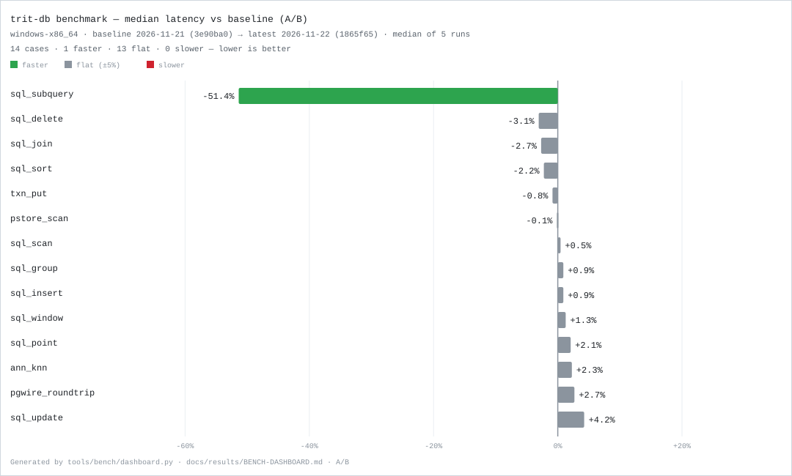
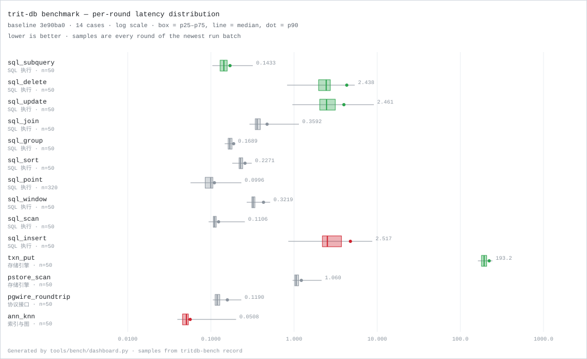

# trit-db 性能涨跌看板

> 基线 `3e90ba0`（2026-11-21）→ 当前 `1865f65`（2026-11-22） · `windows-x86_64` · 15 项 · 最近 5 次同 commit 运行取中位数的中位数 · 延迟越低越好

## 1. 汇总

| 口径 | 更快 / 持平 / 更慢 | Δ% 中位数 |
|---|---|---|
| 5 次聚合（历史） | 6 / 5 / 3 | -2.5% |
| A/B 复核（写路径判定，4 项） | 0 / 4 / 0 | -0.3% |
| 单次直比（仅参考） | 6 / 3 / 5 | -1.5% |

| 重点 | 数值 |
|---|---|
| 最大提升 | `sql_subquery` -57.1%（快 2.33×） |
| A/B 最大退化 | 无（4 项均 <5%，最大 `sql_update` +2.7%） |
| A/B 未复现 | `sql_update` -34.8% → +2.7%；`sql_delete` -25.9% → +1.2% |
| 写路径 A/B | 4 项 -0.3%；0 提升 / 4 持平 / 0 退化 |
| 读 / 写（5 次） | 读 10 项（另 1 项分辨率不足） -5.3%；写 4 项 -16.1% |
| 单次 → 聚合 翻转 | `sql_delete` +35.0% → -25.9% |
| 单次噪声最大 | `sql_delete` 2.401–2.565 ms（6.5×） |

**A/B 复核（写路径，交替运行同一时间窗）**

| 基准项 | 5 次 Δ% | A/B Δ% | 基线 → 当前 (ms) | 交替 | 判定 |
|---|---|---|---|---|---|
| `txn_put` | -0.6%（持平） | -2.5% | 213.0 → 207.6 | 20 对 × 5 轮 | 持平 |
| `sql_insert` | -2.9%（持平） | -1.8% | 2.825 → 2.774 | 20 对 × 20 轮 | 持平 |
| `sql_delete` | -25.9%（大幅提升） | +1.2% | 2.542 → 2.573 | 20 对 × 20 轮 | 未复现 |
| `sql_update` | -34.8%（大幅提升） | +2.7% | 2.526 → 2.593 | 20 对 × 20 轮 | 未复现 |

图表：写路径用 A/B 复核值，其余用 5 次聚合。



## 2. 逐项总表

| 分层 | 基准项 | 基线 (ms) | 当前 (ms) | 5 次 Δ% | 单次 Δ% | 对照 | 5 次区间（基线 / 当前） | 噪声 / 区间 |
|---|---|---|---|---|---|---|---|---|
| SQL 执行 | `sql_subquery` | 0.3220 | 0.1380 | -57.1%（大幅提升） | -58.8%（大幅提升） | 一致 | 0.3190–0.3280 / 0.1230–0.1550 | 中等 / 区间分离 |
| SQL 执行 | `sql_update` | 4.034 | 2.631 | -34.8%（大幅提升） | -43.4%（大幅提升） | 一致 | 1.285–5.759 / 2.334–3.101 | 剧烈 / 区间重叠 |
| SQL 执行 | `sql_delete` | 3.278 | 2.429 | -25.9%（大幅提升） | +35.0%（明显退化） | 相反 | 1.778–11.515 / 2.401–2.565 | 剧烈 / 区间重叠 |
| SQL 执行 | `sql_join` | 0.4310 | 0.3620 | -16.0%（提升） | -14.4%（提升） | 一致 | 0.4120–0.4430 / 0.3290–0.4350 | 中等 / 区间重叠 |
| SQL 执行 | `sql_insert` | 2.694 | 2.615 | -2.9%（持平） | -28.9%（大幅提升） | 不一致 | 1.072–3.677 / 2.450–3.443 | 剧烈 / 区间重叠 |
| SQL 执行 | `sql_point` | 0.1010 | 0.0990 | -2.0%（持平） | -4.0%（持平） | 一致 | 0.1000–0.1030 / 0.0800–0.1060 | 中等 / 区间重叠 |
| SQL 执行 | `sql_sort` | 0.2260 | 0.2280 | +0.9%（持平） | +0.9%（持平） | 一致 | 0.2100–0.2360 / 0.2190–0.2560 | 稳定 / 区间重叠 |
| SQL 执行 | `sql_group` | 0.1650 | 0.1670 | +1.2%（持平） | +25.0%（明显退化） | 不一致 | 0.1280–0.1730 / 0.1600–0.1770 | 中等 / 区间重叠 |
| SQL 执行 | `sql_window` | 0.2910 | 0.3250 | +11.7%（退化） | +8.7%（退化） | 一致 | 0.2810–0.3020 / 0.3130–0.3480 | 稳定 / 区间分离 |
| SQL 执行 | `sql_scan` | 0.0920 | 0.1120 | +21.7%（明显退化） | +12.0%（退化） | 同向 | 0.0730–0.1030 / 0.1030–0.1140 | 中等 / 区间重叠 |
| 存储引擎 | `pstore_scan` | 1.134 | 1.050 | -7.4%（提升） | -11.6%（提升） | 一致 | 1.095–1.144 / 1.011–1.183 | 稳定 / 区间重叠 |
| 存储引擎 | `txn_put` | 195.8 | 194.6 | -0.6%（持平） | +17.2%（退化） | 不一致 | 175.1–243.8 / 185.9–205.3 | 中等 / 区间重叠 |
| 协议接口 | `pgwire_roundtrip` | 0.1310 | 0.1154 | -11.9%（提升） | -12.4%（提升） | 一致 | 0.1199–0.1424 / 0.1127–0.1525 | 中等 / 区间重叠 |
| 索引与图 | `graph_reach` | 0.0010 | 0.0010 | —（分辨率不足） | — | — | — | — |
| 索引与图 | `ann_knn` | 0.0490 | 0.0520 | +6.1%（退化） | +2.2%（持平） | 不一致 | 0.0460–0.0510 / 0.0410–0.0530 | 中等 / 区间重叠 |

## 3. 分布与内存

| 分层 | 基准项 | 样本数 | p50 (ms) | p90 (ms) | max (ms) | RSS 前→后 (MiB) | ΔRSS | 中位数 Δ% |
|---|---|---|---|---|---|---|---|---|
| SQL 执行 | `sql_subquery` | 50 | 0.1433 | 0.1697 | 0.1550 | 10.1 → 11.4 | +1.4 MiB | -57.1% |
| SQL 执行 | `sql_update` | 50 | 2.461 | 3.976 | 3.101 | 10.1 → 11.5 | +1.4 MiB | -34.8% |
| SQL 执行 | `sql_delete` | 50 | 2.438 | 4.302 | 2.565 | 9.9 → 11.3 | +1.4 MiB | -25.9% |
| SQL 执行 | `sql_join` | 50 | 0.3592 | 0.4740 | 0.4350 | 9.8 → 11.2 | +1.4 MiB | -16.0% |
| SQL 执行 | `sql_insert` | 50 | 2.517 | 4.758 | 3.443 | 10.1 → 11.3 | +1.3 MiB | -2.9% |
| SQL 执行 | `sql_point` | 320 | 0.0996 | 0.1102 | 0.1060 | 10.1 → 11.1 | +1.1 MiB | -2.0% |
| SQL 执行 | `sql_sort` | 50 | 0.2271 | 0.2574 | 0.2560 | 10.1 → 11.1 | +1.1 MiB | +0.9% |
| SQL 执行 | `sql_group` | 50 | 0.1689 | 0.1880 | 0.1770 | 10.0 → 11.2 | +1.2 MiB | +1.2% |
| SQL 执行 | `sql_window` | 50 | 0.3219 | 0.4291 | 0.3480 | 10.1 → 11.5 | +1.4 MiB | +11.7% |
| SQL 执行 | `sql_scan` | 50 | 0.1106 | 0.1237 | 0.1140 | 10.0 → 11.1 | +1.1 MiB | +21.7% |
| 存储引擎 | `pstore_scan` | 50 | 1.060 | 1.223 | 1.183 | 10.1 → 10.3 | +0.2 MiB | -7.4% |
| 存储引擎 | `txn_put` | 50 | 193.2 | 222.1 | 205.3 | 10.0 → 10.7 | +0.6 MiB | -0.6% |
| 协议接口 | `pgwire_roundtrip` | 50 | 0.1190 | 0.1577 | 0.1525 | 10.1 → 11.8 | +1.8 MiB | -11.9% |
| 索引与图 | `graph_reach` | 10 | 0.0005 | 0.0006 | 0.0010 | 10.1 → 10.4 | +0.3 MiB | 0.0% |
| 索引与图 | `ann_knn` | 50 | 0.0508 | 0.0564 | 0.0530 | 10.1 → 10.3 | +0.2 MiB | +6.1% |



## 4. 读写路径

| 路径 | 项数 | 5 次平均 Δ% | 5 次 提升 / 持平 / 退化 | 5 次结论 | A/B Δ% 中位数 | A/B 提升 / 持平 / 退化 | A/B 结论 |
|---|---|---|---|---|---|---|---|
| 读路径 | 11（含 1 项分辨率不足） | -5.3% | 4 / 3 / 3 | 整体变快 | — | — | — |
| 写路径 | 4 | -16.1% | 2 / 2 / 0 | 整体变快 | -0.3% | 0 / 4 / 0 | A/B 基本持平 |

## 5. 分层

> 分层与徽章按 A/B 复核写路径；逐项总表保留 5 次历史值。

| 分层 | 项数 | 提升 | 持平 | 退化 | 平均 Δ% | 最大提升 | 最大 Δ% |
|---|---|---|---|---|---|---|---|
| SQL 执行 | 10 | 2 | 6 | 2 | -3.8% | `sql_subquery` -57.1% | `sql_scan` +21.7% |
| 存储引擎 | 2 | 1 | 1 | 0 | -5.0% | `pstore_scan` -7.4% | `txn_put` -2.5% |
| 协议接口 | 1 | 1 | 0 | 0 | -11.9% | `pgwire_roundtrip` -11.9% | `pgwire_roundtrip` -11.9% |
| 索引与图 | 2 | 0 | 0（另 1 项分辨率不足） | 1 | +6.1% | `ann_knn` +6.1% | `ann_knn` +6.1% |

## 6. 运行历史

| 运行 | 日期 | commit | 平台 | 次数 | 项数 | 提升 | 持平 | 退化 | Δ% 中位数 | 最大提升 | 最大退化 |
|---|---|---|---|---|---|---|---|---|---|---|---|
| 基线 | 2026-11-21 | `3e90ba0` | `windows-x86_64` | 5 | 15 | — | — | — | — | — | — |
| 运行批次 | 2026-11-22 | `6ea161d` | `windows-x86_64` | 5 | 15 | 4 | 6（另 1 项分辨率） | 4 | -0.9% | `sql_subquery` -52.5% | `txn_put` +18.4% |
| 运行批次 | 2026-11-22 | `1865f65` | `windows-x86_64` | 5 | 15 | 6 | 5（另 1 项分辨率） | 3 | -2.5% | `sql_subquery` -57.1% | `sql_scan` +21.7% |

## 7. 建议

| 优先级 | 动作 | 依据 |
|---|---|---|
| P0 | 降噪：A/B 交替 20 对；固定电源、绑核、Defender 排除 | `sql_delete` 5 次 2.401–2.565 ms，6.5× |
| P0 | 写路径判定改用 A/B：不再按 5 次聚合判退化 | 4 项 A/B -0.3%，0 退化；`txn_put` +18.4% → -2.5% |
| P0 | 微基准加轮次：update / delete / txn-put 10 轮；insert 每轮 reset 后 10 轮 | `sql_delete` 5 次 1.211–24.735 ms（20.4×）；2 轮中位数不足以判 5% |
| P1 | 锁收益：`sql_subquery` 加入 `exists` / `scalar`，设不回退门限 | `sql_subquery` -57.1%（0.3220 → 0.1380 ms） |
| P1 | 放大 `graph_reach` 规模，或改 1000 次批量计时 | 当前 0.0010 ms，低于 0.01 ms 分辨率 |
| P2 | CI 按平台各存基线，或在 Windows runner 定时跑基准 | 现在用 Windows 基线在 Ubuntu 上只挡 3× 量级 |
| P2 | 看板补 p50 / p90 与箱线图 | `record` 已把每轮 samples 写进 JSON；看板仍只显示 min / median / max |

## 8. 口径

```bash
python tools/bench/run.py --repeat 5   # 跑 5 轮并写 docs/results/bench-runs/
python tools/bench/run.py --repeat 5 --rounds 10   # 可选：非累积型 case 提到 10 轮
python tools/bench/ab.py --baseline-bin <baseline-bin> --pairs 20   # 写路径 A/B
python tools/bench/dashboard.py      # 只重建看板
cargo run --release -p tritdb-bench -- check \
  --baseline docs/results/bench-baseline.json --tolerance 2.0 --min-ms 0.05 \
  --rounds 10 --retries 2
```

判定：|Δ| < 5% 持平，≥5% 提升/退化，≥20% 大幅提升/明显退化；基线 < 0.01 ms 记分辨率不足。写路径以 A/B 复核为准，5 次表保留作历史。`sql_insert` 自本轮起改为每轮 reset；此前的 5 次值是累积语义。`record` 输出每轮 `samples`，`promote_baseline.py` 会把 5 次运行的样本合并进基线。CI 只校验看板可复现。

